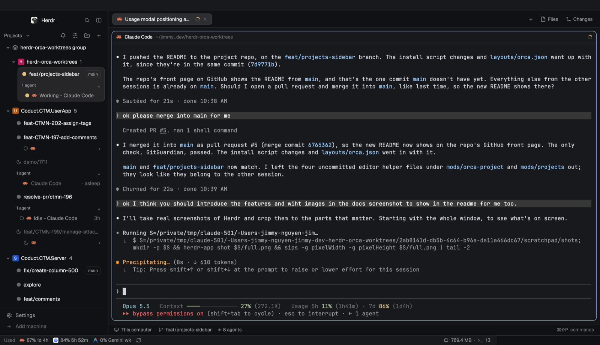
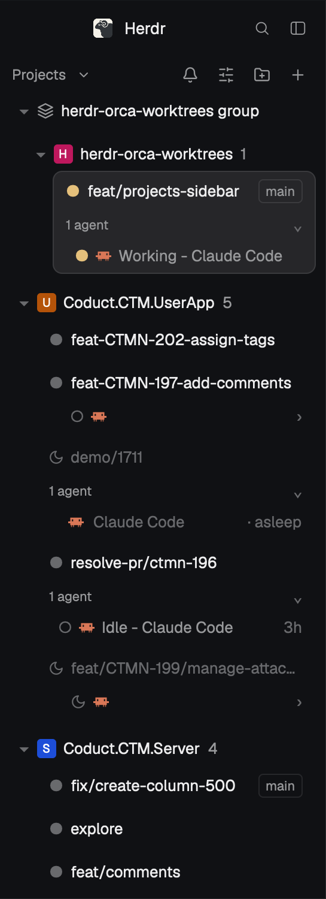
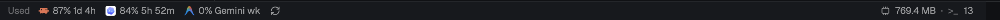
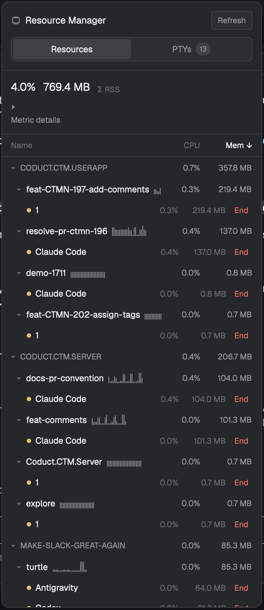

# herdr-orca-worktrees

Orca-style chrome for [Herdr.app](https://herdr.dev): a projects sidebar with worktree cards, sleep and wake, project icons and groups, "Open in" editors, usage meters, and a resource manager. All of it is Herdr **mods** plus a small Node CLI (`orca-wt`). Herdr itself isn't changed.



## Features



### Projects sidebar

- **A tree of project groups, projects and worktrees.** Each project shows its GitHub avatar, a repo icon or a coloured letter. You can **Rename…** or **Change icon…** from the right-click menu.
- **Worktree cards.** The selected card is outlined.
  - The `main` badge marks the main checkout.
  - The agents fold into one strip that shows the most urgent status (blocked `!`, working `●`, done `✓`, idle `○`).
  - Click the strip for the list. Each row reads like "Working - Claude Code", and clicking it jumps to that agent.
- **New worktree with an agent:** use `+` on a project header. Agents start with full access.
- **Sleep and wake:** sleep quits a worktree's agents and remembers how to resume them (🌙). Wake brings them back in the same conversations. A half-typed draft is never lost.
- **Right-click menus:**
  - **Open in ›** VS Code, Zed, Xcode, Finder and more, plus **Customize apps…**.
  - **Project Group ›** to put related repos in a group that folds as one.

<br clear="right">

### Usage meters and resource manager



**Usage meters (left):** the bottom bar shows how much of your Claude, Codex and Antigravity plan you've used, and when each window resets. Click it for an Orca-style popup with Detailed or Compact rows.



**Resource chip (right):** `▭ 769 MB · >_ 13` is the total memory of every terminal plus Herdr itself, and the number of terminals. Click it for the **Resource Manager**:

- **Resources:**
  - CPU and memory for each project, worktree and terminal, sortable by any column.
  - A 2-minute memory graph for each worktree.
  - Click a terminal to jump to it.
- **PTYs:** every Herdr terminal with its details. Jump to one, or **End** one or several (it always asks first).

It samples `ps` every 2 seconds while open and every 5 seconds otherwise, and it never calls the Orca app.

<br clear="right">

### Also included

- **Create worktree** dialog, with a local and remote branch picker and `orca.yaml` setup scripts.
- **Remove worktree** dialog, with archive handling.
- **Git panel:** click **Git** beside **Files** and **Changes** for a VS Code style Source Control view of the selected worktree. Enter a commit message, stage (`+`) or unstage (`−`) individual files or entire groups, then commit the staged changes. The **Staged Changes** and **Changes** group titles remain visible with file counts, including when empty. Select a title by clicking it or using `j/k`, then press `s` to stage all Changes or unstage all Staged Changes. The title’s `+`/`−` buttons do the same; click its chevron to collapse the group. Merge conflicts appear separately; new files appear under Changes. Selecting a file shows the staged or working version with old/new line numbers. Branch and ahead/behind counts appear above the message. **Open in Neovim** opens the selected working file in a terminal pane beside the current pane (or a new tab if no pane exists). Neovim must be available as `nvim` on PATH. Use `:w` to save and `:q` to close its pane, then `r` or `↻` to refresh Git immediately. Staged selections open the working file; saving does not stage it. Commit drafts are remembered per worktree while the panel stays open; failed commits preserve the message. **History** retains the latest 100 commits, their changed files, and per-file diffs (merges compare to their first parent). The panel refreshes every 10 seconds; `↻` refreshes immediately. Drag the dividers to resize the commit form, file list, and diff; History sections resize too. Sizes are saved across refreshes, mode switches, and app restarts. **Commits…** in a worktree's right-click menu opens a wider dialog with the same views. See [VS Code Git investigation](docs/vscode-git-investigation.md) for reference evidence and scope.
- **Vim navigation in Git:** click inside the panel, then use `j/k` to move through commits, files, or diff lines; `h/l` to move between sections; `gg/G` for first/last; and `Ctrl-d/u` to move half a page in the diff. Counts such as `5j` work. In Changes, `i` focuses the commit message, `Esc` returns to navigation, `s` stages the selected working file or unstages the selected staged file, `r` refreshes and `⌘Enter` in the message commits staged files. Typing in the message field bypasses Vim navigation. Arrow keys, Enter, and Tab/Shift-Tab also navigate. Escape returns to the previous section, then to the terminal; `q` closes Git.
- Orca-style tabs.

## Requirements

- **macOS** with **Herdr.app** installed and opened once, so `~/.config/herdr-app` exists. `herdr-app` and `hc` come with it.
- **Node 20 or newer** on your `PATH` (`node --version`).
- **git.**
- **Optional:**
  - the `claude`, `codex` and `agy` CLIs, signed in, for the usage meters and for agents in new worktrees;
  - `gh` (GitHub CLI), signed in, so worktree names drop your `<login>/` prefix.

## Install

```bash
git clone git@github.com:nguyenchanh0201/herdr-orca-worktrees.git
cd herdr-orca-worktrees
bash scripts/install.sh
```

That's all. The script:

1. Installs the CLI's npm dependency (`yaml`) if it's missing.
2. Copies every mod in `mods/` to `~/.config/herdr-app/mods/`. It writes each mod a `config.js` holding the paths of your `node` and of `bin/orca-wt.js`.
3. Copies `layouts/orca.json` to `~/.config/herdr-app/layouts/` if you don't have one. For an existing Orca layout with the standard panel stack, it adds Git and enables the Orca tab bar, preserving customizations and saving `orca.json.before-git` as a backup.
4. Runs `herdr-app check` on every mod.
5. Switches the open Herdr window to the `orca` layout, if the layout was just installed.

You should see `all mods passed herdr-app check`. If Herdr wasn't open, open it and press **ctrl-shift-l** until the orca layout shows. That key cycles through layouts, so you can always switch back to your old one.

## Check it worked

- **Left sidebar:** shows **Projects**. Use `+` on a project header to create a worktree.
- **Bottom bar:** shows usage meters (`5h … · 7d …`) and the resource chip (`▭ 2.14 GB · >_ 5`).
- **Top right:** **Files**, **Changes**, and **Git** toggle the side panel.
- **Right-click a worktree card:** you get Sleep, Open in ›, Commits…, and the rest.

## Update

```bash
git pull
bash scripts/install.sh
```

To reinstall just some mods, which is faster when you're working on one, name them:

```bash
bash scripts/install.sh projects orca-project
```

That form skips layout installation and checks, but applies the small Git panel upgrade to an existing Orca layout when both companion mods are installed. Run `herdr-app check ~/.config/herdr-app/mods/<mod>` yourself afterwards.

## Rust CLI (optional)

`rust/` is a Rust port of `bin/orca-wt.js`. The Git panel currently requires the Node CLI; its source control and commit browsing subcommands are not yet ported. To build the Rust CLI and point the installed mods at the binary:

```bash
bash scripts/install-rust.sh
```

Switch back to the Node CLI with `bash scripts/install.sh`.

### Install the prebuilt binary

On Apple Silicon Macs, check out the tag for the [release](https://github.com/nguyenchanh0201/herdr-orca-worktrees/releases) you want and run `bash scripts/install.sh` to install the mods. Download `orca-wt-darwin-arm64.tar.gz` and its `.sha256` file into the same directory. Verify the archive and extract the binary to a permanent location.

```bash
shasum -a 256 -c orca-wt-darwin-arm64.tar.gz.sha256 &&
  mkdir -p ~/.local/bin &&
  tar -xzf orca-wt-darwin-arm64.tar.gz -C ~/.local/bin
```

From the release checkout, run `bash scripts/install-rust.sh ~/.local/bin/orca-wt`. This path uses the downloaded binary without Cargo. Keep the binary at that path while the mods use it.

## Uninstall

```bash
cd ~/.config/herdr-app
rm -rf mods/{orca-setup,orca-remove,projects,orca-worktree,orca-project,orca-commits,orca-usage,orca-usage-panel,orca-tabs,orca-resources,orca-resources-panel} orca-icons
rm layouts/orca.json
```

Then press ctrl-shift-l to get back to another layout. Your saved data (below) stays unless you delete it as well.

## Where your data lives

| What | Where |
|---|---|
| Saved projects, names, icon choices, groups | `~/.local/state/orca-worktrees/projects.json` |
| "Open in" app choice | `~/.local/state/orca-worktrees/apps.json` |
| Downloaded project icons | `~/.config/herdr-app/data/project-icons/` |
| A worktree's sleeping agents | inside that worktree's git folder |

## Troubleshooting

- **A mod shows nothing, or Herdr says it failed:** run `herdr-app check ~/.config/herdr-app/mods/<mod>`. It names the file and the error.
- **The sidebar shows no projects after you add one from a terminal:** run `bash scripts/install.sh projects`, which reloads it.
- **Everything broke after a Node upgrade (for example with nvm):** each mod's `config.js` holds the old `node` path, so run `bash scripts/install.sh` again.
- **Your layout didn't change after an update:** the script never overwrites `layouts/orca.json`. To take the repo's version, first back yours up, for example by moving `~/.config/herdr-app/layouts/orca.json` to `orca.json.bak`, then rerun the install.

## For agents setting this up

Do these in order, and stop and report if any step fails:

1. Check the requirements:
   - `node --version` is 20 or newer;
   - `git --version` works;
   - `ls ~/.config/herdr-app` exists. If it doesn't, ask the person to open Herdr.app once.
2. From the repo root, run `bash scripts/install.sh`. Expected: the last lines are `installed layout: orca`, or `kept your existing layouts/orca.json`, and then `all mods passed herdr-app check`.
3. If a check failed, run the `herdr-app check …` command it printed and fix what it names. Don't edit `~/.config/herdr-app/mods/` directly. Edit `mods/` in the repo and reinstall.
4. Confirm with `herdr-app shot /tmp/herdr.png` and look at the image. The Projects sidebar should be on the left and the usage strip and resource chip at the bottom. If it still shows another layout, run `herdr-app do layout.switch --name orca`.
5. Never overwrite the person's existing `~/.config/herdr-app/layouts/orca.json` without asking.

## Develop

```bash
npm install
npm test        # node --test
```

API docs for mods are in `~/.config/herdr-app/AGENTS.md`, `herdr.d.ts` and `gpui-kit.d.ts`. Designs and build plans are in `docs/superpowers/`.

### CI and releases

GitHub Actions runs the Node and Rust tests, builds an Apple Silicon release binary, and verifies both installer paths and layout preservation on PRs into `main` and pushes to `main`. The installer smoke test uses a pinned Herdr version.

After the first hosted run passes, make **Verify macOS ARM64** a required status check on `main`. To cut a release, push a `vMAJOR.MINOR.PATCH` tag pointing to a commit on `main`. The release workflow reruns CI and creates a draft GitHub Release with the tested archive and checksum. Review the draft before publishing it. If an asset upload fails and GitHub leaves an incomplete draft, remove that draft before rerunning the failed release job.
